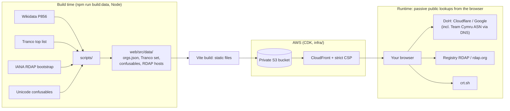

# Izanami

_See through lookalike domains._ Named after the Naruto technique that traps an opponent in a loop until they accept the truth.

Is `tudeIft.nl` really TU Delft? This static website shows the known official domains of about
500 well-known organisations and checks whether another domain is a **lookalike** that could be
used for phishing (typos, homoglyphs, TLD swaps, combo-squats, subdomain tricks). It explains
every rule it applies (fired, not fired or unknown) and gives a heuristic verdict.

Static web app (`web/`) deployed to S3 + CloudFront by the CDK app in `infra/`. Everything runs in
your browser: there is no backend and no analytics.

<!-- TODO(ticket 11): add screenshots of the landing page, an organisation page and a lookup
result (e.g. docs/screenshots/*.png) once the lookup terminal (ticket 06) has landed. -->

## How it works



- Official domains are resolved **at build time**: an organisation is listed only when Wikidata
  and Tranco agree. The browser never calls Wikidata or Tranco.
- A lookup normalises the input to its registrable domain, then queries DNS-over-HTTPS, RDAP and
  Certificate Transparency directly from the browser and scores the result with a small,
  transparent rules engine (`web/src/rules/`).
- The site's footer has a **"What this tool sends where"** panel listing every third party a
  lookup contacts.

Design decisions are recorded as ADRs:

- [ADR-0001: Browser-only runtime, no Lambda](docs/adr/0001-browser-only-runtime.md)
- [ADR-0002: Resolve official domains at build time](docs/adr/0002-build-time-resolution.md)
- [ADR-0003: Weighted additive scoring with explicit unknowns](docs/adr/0003-scoring-model.md)
- [ADR-0004: Strict security headers with a generated CSP allowlist](docs/adr/0004-security-headers.md)

See also the [spec](docs/SPEC.md) and [glossary](docs/GLOSSARY.md).

## Ethics: passive lookups only

This tool only reads public records about a domain: DNS, registration data (RDAP) and
Certificate Transparency logs. It never contacts the domain being checked: no HTTP requests,
screenshots, port scans or crawling. Its verdict is a heuristic, not a guarantee, and "official"
means "listed as official by Wikidata and heavily used per Tranco", not proof of ownership.
Please don't use it to harass domain owners; report suspected phishing to the registrar or the
targeted organisation.

## Development

```sh
npm ci
npm run lint
npm test
npm run build          # also builds web/dist, needed by cdk synth/deploy
npm run synth -w infra
```

## Deployment

Every push to `main` runs `.github/workflows/deploy.yml`: install, lint, test, build, then
`cdk deploy IzanamiStack`. Any failing step stops the job before AWS credentials are
requested. AWS access uses GitHub OIDC: there are no AWS keys in GitHub secrets. The deploy role
only trusts tokens whose subject is `repo:<owner>/<name>:ref:refs/heads/main`, so pull requests
and forks cannot assume it, and its only permission is assuming the CDK bootstrap roles.

### One-time setup

Run these once with admin credentials for the target AWS account, from the repo root.
`<owner>/<name>` is the GitHub repository (for example `my-org/izanami`).

1. Build the site (the CDK app needs `web/dist`):

   ```sh
   npm ci && npm run build
   ```

2. Bootstrap CDK in the account and region you will deploy to:

   ```sh
   cd infra
   npx cdk bootstrap aws://<account-id>/<region>
   ```

3. Create the GitHub OIDC provider and deploy role:

   ```sh
   npx cdk deploy IzanamiGitHubDeploy -c githubRepo=<owner>/<name>
   ```

   The repository can also be given as the `GITHUB_DEPLOY_REPO` environment variable.
   Optional context values:
   - `-c githubBranch=<branch>`: allow a branch other than `main`.
   - `-c githubOidcProviderArn=<arn>`: reuse an existing
     `token.actions.githubusercontent.com` provider (an account can have only one), instead of
     creating it.
   - `-c @aws-cdk/core:bootstrapQualifier=<qualifier>`: if you bootstrapped with a custom
     qualifier.

4. In GitHub, under Settings → Secrets and variables → Actions → Variables, add two
   repository variables (variables, not secrets):
   - `AWS_ROLE_ARN`: the `DeployRoleArn` output of step 3.
   - `AWS_REGION`: the region you bootstrapped in step 2.

After that, a push to `main` deploys. The `DistributionUrl` output of `IzanamiStack`
is the site URL.
