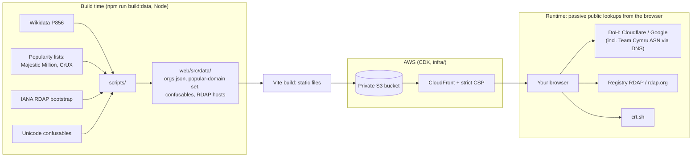

# Izanami

_See through lookalike domains._ Named after the Naruto technique that traps an opponent in a loop until they accept the truth.

Is `tudeIft.nl` really TU Delft? This static website shows the known official domains of about
1,000 well-known organisations and checks whether another domain is a **lookalike** that could be
used for phishing (typos, homoglyphs, TLD swaps, combo-squats, subdomain tricks). It explains
every rule it applies (fired, not fired or unknown) and gives a heuristic verdict.

Static web app (`web/`) deployed to S3 + CloudFront by the CDK app in `infra/`. Everything runs in
your browser: the website has no backend and no analytics. An optional [JSON API](#json-api)
(`api/`, AWS Lambda) runs the same checks for scripts.

<!-- TODO(ticket 11): add screenshots of the landing page, an organisation page and a lookup
result (e.g. docs/screenshots/*.png) once the lookup terminal (ticket 06) has landed. -->

## How it works



- Official domains are resolved **at build time**: an organisation is listed only when Wikidata
  and the popularity lists agree. The browser never calls Wikidata or the lists.
- A lookup normalises the input to its registrable domain, then queries DNS-over-HTTPS, RDAP and
  Certificate Transparency directly from the browser and scores the result with a small,
  transparent rules engine (`web/src/rules/`).
- The site's footer has a **"What this tool sends where"** panel listing every third party a
  lookup contacts.

Design decisions are recorded as ADRs:

- [ADR-0001: Browser-only runtime, no Lambda](docs/adr/0001-browser-only-runtime.md)
- [ADR-0002: Resolve official domains at build time](docs/adr/0002-build-time-resolution.md)
- [ADR-0003: Weighted additive scoring with explicit unknowns](docs/adr/0003-scoring-model.md)
- [ADR-0004: Strict security headers with a generated CSP allowlist](docs/adr/0004-security-headers.md)
- [ADR-0006: JSON API on a Lambda function URL behind CloudFront](docs/adr/0006-json-api.md)

See also the [spec](docs/SPEC.md) and [glossary](docs/GLOSSARY.md).

## Ethics: passive lookups only

This tool only reads public records about a domain: DNS, registration data (RDAP) and
Certificate Transparency logs. It never contacts the domain being checked: no HTTP requests,
screenshots, port scans or crawling. Its verdict is a heuristic, not a guarantee, and "official"
means "listed as official by Wikidata and heavily used per the popularity lists", not proof of ownership.
Please don't use it to harass domain owners; report suspected phishing to the registrar or the
targeted organisation.

## JSON API

Other tools can get the same result the website shows, as JSON, without a browser. It is served
by the AWS deployment (not GitHub Pages) under `/api/`: a Lambda function that imports the
website's own modules, behind CloudFront ([ADR-0006](docs/adr/0006-json-api.md), full reference
in the [spec](docs/SPEC.md#api)).

```sh
API=https://d1kyj53r37y0uu.cloudfront.net/api

# Check a domain against an organisation: the website's "Export JSON" document
curl "$API/check?org=google&domain=c.gle"        # verdict.label "Official" (Google runs .gle)
curl "$API/check?org=google&domain=gooogle.com"  # scored: verdict, why, every rule, facts
curl "$API/check?org=google&domain=meebo.com"    # Wikidata-listed: scored, not Official

# Just the verdict and the reasons (with jq)
curl -s "$API/check?org=tu-delft&domain=tudeIft.nl" | jq '{verdict, why}'

# Organisations and their official context
curl "$API/orgs"          # [{ "id": "google", "name": "Google", "primaryDomain": "google.com" }, ...]
curl "$API/orgs/google"   # official domains (trust level), Wikidata-listed related domains, brand TLDs
curl "$API/health"        # { "ok": true, "dataVersion": "2026-11-19" }
```

- `org` is an id from `/api/orgs` (the slug in `/#/org/<slug>`); `domain` is a bare domain
  name (Unicode or punycode; no scheme, path or port), at most 253 characters.
- Errors are JSON `{ "error": { "code", "message" } }`: 400 bad or missing input, 404 unknown
  org or route, 405 non-GET, 500/504 failure or timeout.
- Answers are cached by CloudFront for an hour per `org` + `domain`, so repeat checks are instant
  and send nothing upstream (`x-cache: Hit from cloudfront`). `Access-Control-Allow-Origin: *`.
- Privacy: unlike the website, a query sent to the API passes through our Lambda. Its logs (kept
  a week) hold only Lambda's per-request start/end/duration lines and, for server errors, the
  status and error code; never the domain, query string or your IP.

## Development

```sh
npm ci
npm run lint
npm test
npm run build          # builds web/dist (the site GitHub Pages publishes)
npm run synth -w infra
```

## Deployment

Live site:

- **AWS (S3 + CloudFront, full security headers):** https://d1kyj53r37y0uu.cloudfront.net/
- **GitHub Pages (auto-deployed on every push):** https://calinsuconicovsafemarker.github.io/izanami/

The site is hosted on **GitHub Pages** ([ADR-0005](docs/adr/0005-github-pages-hosting.md)). Every
push to `main` runs `.github/workflows/pages.yml`: install, lint, test, build, then publish
`web/dist`. Any failing step stops the job before anything is published. No secrets are involved.

GitHub Pages can't set response headers, so the strict Content-Security-Policy (including the
generated RDAP `connect-src` allowlist) is injected into `index.html` as a `<meta>` tag at build
time, and `web/check-dist-csp.mjs` fails the build if it's missing or if any inline script or
style appears.

One-time setup: in the repository, Settings → Pages → Build and deployment → Source:
**GitHub Actions**.

### Optional: AWS hosting

`infra/` still contains a CDK app for S3 + CloudFront (Origin Access Control, header-based CSP via
a CloudFront Function, HSTS), the JSON API (Lambda function URL behind the same distribution,
bundled locally with esbuild, no Docker needed) and a GitHub OIDC deploy role (`IzanamiStack`,
`IzanamiGitHubDeploy`). It is deployed manually from a laptop (`aws login`, then `npm run build && cd infra && npx cdk deploy IzanamiStack`), not from GitHub, because the AWS account's organisation blocks GitHub OIDC; see
[ADR-0004](docs/adr/0004-security-headers.md). To use it: `npm run build`, then
`cd infra && npx cdk bootstrap aws://<account-id>/<region>` and `npx cdk deploy IzanamiStack`.
